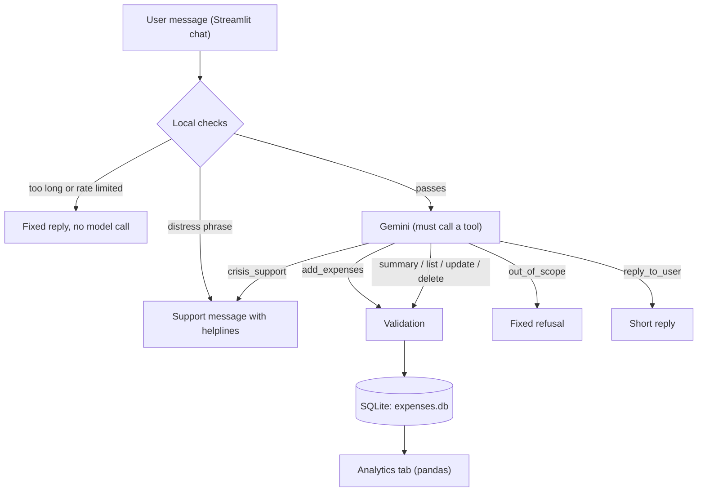

# Expense Tracker: an LLM chatbot for daily spending

Type what you spent in plain English, Hindi or Hinglish, and the bot logs it to a database.
Then analyse your spending in a dashboard or ask questions in the same chat.

> "had chai for 15 and auto 120 yesterday"  ->  two rows saved with item, amount (Rs), category, date and time

<!-- TODO: add screenshots to a docs/ folder, then keep or edit these lines -->
![Chat tab]


## What it does

- **Logs expenses from natural language.** Several items in one message, relative dates ("yesterday", "last Friday"), and amounts like "2k" or "1,299" are all covered by the test messages.
- **Edits and deletes by chat.** "Make the auto 100", "delete the chai entry".
- **Answers spending questions.** "How much did I spend on food this week?"
- **Analytics dashboard.** Daily spend with a 7-day average, category shares, monthly totals, weekday vs weekend, top items, biggest expenses, month-over-month comparison on equal days, and CSV export.
- **Stays on topic.** It only handles expenses. Code requests, trivia, and prompt-injection attempts get a fixed refusal, and messages about self-harm get a supportive reply with helpline numbers.

## How it works



**Stack:** Python, Google Gemini API (`google-genai`), SQLite, pandas, Streamlit.

## Design decisions

**Tool calling instead of parsing text.** The model returns structured arguments
(`item`, `amount_inr`, `category`, `spent_at`) through function calling, so there is no fragile regex or JSON-in-prose parsing.

**The model cannot write free text.** The API is called in function-calling mode `ANY`, so every turn must be a tool call. Short messages go through a `reply_to_user` tool, which is length-capped. This is what stops it from answering "write me a Python program" at all, instead of relying on a prompt that says "please don't".

**Guardrails live in code, not only in the prompt.**

| Guardrail | What it does |
|---|---|
| Out-of-scope tool | Off-topic requests call `out_of_scope`; the app shows a fixed message |
| Input cap | Messages over 300 characters are rejected before any API call |
| Rate limit | 20 messages per user per 10 minutes (configurable) |
| Short history | Only the last 6 messages are sent to the model, so token use stays flat |
| Step cap | At most 5 model calls per message |
| Validation | Amount must be above 0 and at most 10 lakh, dates can't be in the future, item names are cleaned, a bad entry saves nothing |
| Delete/update guard | The model may only change an entry whose id it looked up in the same turn |
| Safety path | Distress phrases (English and Hinglish) are caught locally with no model call; the model also has a `crisis_support` tool for other wording |

**One model call per expense.** For a plain "I bought X" message the confirmation is built locally,
so adding an expense costs one request instead of two. Thinking is set to low by default because
expense parsing doesn't need long reasoning.

**Why no LangChain?** The loop is small (one model, eight tools), and writing it directly keeps
every guardrail visible and testable in plain Python. A framework would add a layer without removing any work here.

**SQLite.** One file, zero setup, and a good fit for a single-user app. SQL queries are parameterised, and the
model never writes SQL: it can only call fixed tools with typed arguments.

## Setup

Requires Python 3.10+ and a free Gemini API key from [Google AI Studio](https://aistudio.google.com/apikey).

```bash
git clone <your-repo-url>
cd expense_tracker

# using uv (or use python -m venv .venv and pip)
uv venv
.venv\Scripts\activate          # Windows;  Mac/Linux: source .venv/bin/activate
uv pip install -r requirements.txt

copy .env.example .env          # Mac/Linux: cp .env.example .env
# open .env and set GEMINI_API_KEY=your_key
```

Run the app:

```bash
streamlit run app.py
```

### Configuration (`.env`)

| Variable | Default | Meaning |
|---|---|---|
| `GEMINI_API_KEY` | none (required) | Your Gemini key |
| `EXPENSE_MODEL` | `gemini-flash-latest` | Any Gemini model your key can use |
| `EXPENSE_THINKING` | `low` | `low`, `off` or `default`; lower is faster |
| `EXPENSE_DB` | `expenses.db` | Path of the SQLite file |
| `EXPENSE_RATE_LIMIT` | `20` | Messages per user per 10 minutes |

`.env`, `expenses.db` and `demo.db` are in `.gitignore`, so your key and your spending data stay out of git.

### Try it with fake data

```bash
python seed_demo.py                                  # creates demo.db with ~120 days of sample spending
$env:EXPENSE_DB="demo.db"; streamlit run app.py      # PowerShell;  Mac/Linux: EXPENSE_DB=demo.db streamlit run app.py
```

## Testing

**Offline guardrail tests** (19 tests, no API key or internet needed). The model is replaced by a
scripted fake, including one that misbehaves on purpose:

```bash
python test_guardrails.py
```

**Parsing evaluation** against the real model (39 labelled messages: single and multiple items,
relative dates and times, Hinglish, and cases where nothing may be logged):

```bash
python eval.py          # writes eval_results.json
```

<!-- TODO: run python eval.py and fill in the real numbers. Do not publish placeholders. -->

| Model | Cases fully correct | Item + amount precision / recall | Category accuracy | Date/time accuracy |
|---|---|---|---|---|
| _fill in_ | _x / 39_ | _x% / x%_ | _x%_ | _x%_ |

## Project structure

```
core.py            database, validation, LLM tools, chat loop, guardrails
analytics.py       pandas functions behind the dashboard (no UI code)
app.py             Streamlit app: Chat tab + Analytics tab
eval.py            runs eval_cases.py against the model and reports accuracy
eval_cases.py      labelled test messages
test_guardrails.py offline tests with a fake model
seed_demo.py       generates fake data in a separate demo.db
```

## Limitations

- Single user, local SQLite file; no login. Don't expose the Streamlit app to the internet as it is.
- Amounts are in Indian rupees only.
- Even an off-topic message costs one small model request (the long answer is gone, the request is not).
- The distress-phrase list is a safety net, not complete coverage, and this app is not a mental-health service.
- Accuracy depends on the model; the Gemini free tier has daily request limits.

## Roadmap

- [ ] Telegram bot, so expenses can be logged from a phone
- [ ] Cloud deployment (storage layer with SQLite locally and Firestore in the cloud)
- [ ] Budget alerts per category
- [ ] Spending forecast and unusual-day detection